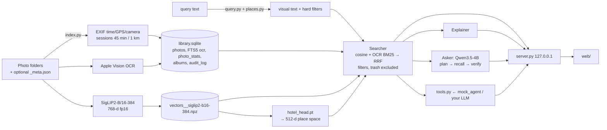

# Architecture

A private, local-first semantic photo search. The Python engine in `search/` is the reference implementation, and the web UI is its demo. The iOS and Android apps port the same pipeline to run on-device. Nothing calls a cloud API (see [privacy.md](privacy.md)).

## Components

| Part | Where | Role |
|---|---|---|
| Encoders | `search/photosearch/encoders.py` | Every embedding model behind one interface (`encoders.get(name)`). The default is `siglip2-b16-384`. |
| Same-place head | `photosearch/heads.py`, `search/train/` | Our own model. A small MLP on frozen SigLIP2 vectors, trained for "same room/place". Weights in `search/data/models/hotel_head.pt`. |
| OCR | `photosearch/ocr.py` | Apple Vision, on-device. Fast mode at index time. `Library.ocr_accurate` re-runs selected photos in accurate mode. |
| Library / index | `photosearch/library.py`, `search/index.py` | Ingest folders. Stores metadata, OCR and FTS5 in SQLite, plus one vector matrix per model. |
| Query parsing | `photosearch/query.py`, `photosearch/places.py` | Rule-based, about 3 ms. Turns dates ("last summer", "sept 29 2025") and places (aliases in 29 languages via pycountry, plus the library's own place names) into hard filters. |
| Search | `photosearch/search.py` | Hybrid retrieval: vectors + OCR full text, fused by RRF, then filters. A "place" mode uses the trained head. |
| Explain | `photosearch/explain.py` | "Why it matched": about 300 zero-shot concepts scored with SigLIP's sigmoid head. |
| Ask | `photosearch/ask.py` | A local VLM (Qwen3.5-4B) plans the search, recalls candidates, then checks contact sheets of the top hits. |
| Cleanup | `photosearch/cleanup.py` | Explainable "photos you may not need" candidates. It never deletes anything. |
| Agent tools | `photosearch/tools.py` | 15 JSON-schema tools: search, albums, soft delete (trash), cleanup. Destructive ones need a dry run plus a confirm token. |
| Mock agent | `search/mock_agent.py`, `search/agent_stub.py` | A rule-based `Planner` plus an `Executor` that owns confirm and undo. `agent_stub.py` is where your own LLM planner plugs in. |
| Guard + watchdog | `photosearch/guard.py`, `search/watchdog.py` | A machine-wide ML budget and a pressure check, plus a last-resort job killer ([development.md](development.md#resource-safety)). |
| Server | `search/server.py`, `search/api_{tools,ask,agent}.py` | FastAPI on 127.0.0.1 (:8000; staging :8100). Local-only middleware. Serves the API, photos and `web/dist`. |
| Web | `web/` | React 19 + Vite + Tailwind 4. Pill with search, Ask and Agent; match card; scroll story; physically based liquid glass (`components/Glass.tsx`). |
| iOS | `ios/` | SwiftUI. SigLIP2 Core ML (image + text), Swift tokenizer, Vision OCR, SQLite/FTS5, `PhotoTools`. See the README's ios section. |
| Android | `android/` | Kotlin/Compose. SigLIP2 ONNX int8, Kotlin tokenizer, no INTERNET permission. See [android/README.md](../android/README.md). |
| ml | `ml/`, `ml/android/` | Converts SigLIP2 to Core ML and ONNX. Tokenizer export and parity checks. |
| backend | `backend/` | Legacy stub with empty `/v1/*` routes, superseded by `search/server.py`. |

## Data flow

1. **Ingest** (`make index DIR=…` or `python index.py FOLDER[=ALBUM]`). Files are registered by absolute path and never copied. The indexer reads EXIF plus an optional `_meta.json` sidecar and groups photos into shooting sessions. It then runs OCR, then embedding. Vectors are written in chunks through an atomic `os.replace`.
2. **Store.** SQLite in WAL mode holds the metadata and an FTS5 index (search ranks only the `ocr` column). The vectors live in one dense `.npz`. When `Searcher` loads, it projects them through the head and caches per-row columns (date, place, album, GPS, has-text), so filters are vectorised numpy masks.
3. **Search.** The search box calls `/api/search` with `Query.parse=True`. Parsed dates and places become filters that must all hold, and the remaining text is embedded as a prompt ensemble ("x" + "a photo of x"). Ranking is the cosine top-k plus an OCR BM25 vote (weight 0.8, with an exact phrase forced to the top), fused by RRF (k = 60). If no visual text remains, the filter's matches come back newest first. `/api/search` returns what it understood as `parsed`.
4. **Photo queries.** `mode="similar"` is raw SigLIP2 cosine with **session propagation**: photos from the same session as a strong match inherit 0.9× its score. `mode="place"` runs the cosine in the head's space instead. It powers the "Same place →" button, `/api/similar?mode=place` and Ask's `same_place` role.
5. **Explain / Ask / Agent.** Explain names the shared concepts. Ask takes 10–60 s and runs one question at a time. The web UI sends question-like input to Ask (`web/src/ask.ts`) and imperative commands to the agent (`web/src/agent.ts`). The agent executor dry-runs destructive steps, shows a preview, and runs them only after `/api/agent/confirm`. Every change it makes can be undone.

The server opens the index **read-only** for search and checks the vector file's mtime on each request, so `index.py` can run alongside it. `tools.py` opens its own WAL write connection for albums, trash and the audit log. Soft-deleted photos are excluded from every search path and from the browse wall.

## Scale

`search/data/index` holds 21,389 photos: Unsplash 15k, Hotels-50K test 5.4k and Flickr30k 1k. `search/data/index-xl` holds 72,887: Unsplash Lite 25k, Places365 val 36.5k, COCO val 5k, Hotels 5.4k and Flickr 1k. `make start` serves the XL index when it exists. Search is brute force: 72,887 × 768 floats is about 224 MB of RAM, plus the 512-d head space, and that is fast enough that there is no ANN index.

## Key design decisions (numbers from [search/NOTES.md](../search/NOTES.md) and `search/experiments/results/`)

- **One SigLIP2-B/16-384 embedding.** It won both benchmarks: Hotels R@1 0.196 vs 0.165 for CLIP-B/32, and Flickr text→image R@1 0.818 vs 0.667. Its sigmoid head gives calibrated probabilities, which explain and cleanup reuse, so neither needs another model. Qwen3-VL alternatives were evaluated and not shipped ([ml.md](ml.md)).
- **Parse dates and places into hard filters.** Plain embeddings ignore time. On the 91-query eval, hit@1 went from 0.593 to 0.736 and hit@10 from 0.747 to 0.890. Time queries went from hit@10 0.167 to 1.0. On the XL eval (104 queries, 72,887 photos), hit@1 is 0.663 and hit@10 is 0.846. The rules are deterministic and take about 3 ms, so the search box needs no LLM.
- **Hybrid retrieval, OCR only.** Embeddings miss literal text. Re-running OCR in accurate mode dropped garbage text and raised text_in_photo hit@1 from 0.93 to 1.0. Place names are filters, not votes.
- **Train a small head instead of fine-tuning.** The head works on the vectors already stored, so nothing is re-embedded and training takes about 1 min on CPU. Hotels R@1 rose from 0.196 to 0.359 and mAP from 0.113 to 0.252. On the whole library, R@1 rose from 0.162 to 0.306. In the eval, same_room hit@1 rose from 0 to 0.25 and MRR from 0.07 to 0.30.
- **SQLite + one `.npz`, no vector DB.** Both stores are single local files, which keeps privacy simple. Atomic writes plus a read-only server let indexing and serving overlap.
- **Ask verifies instead of trusting recall.** A 4-bit Qwen3.5-4B judges numbered contact sheets, so it answers only from what it sees. It is slow, so it runs only for questions.
- **Agents are soft, two-step and auditable.** Trash is a flag, destructive calls replay an HMAC token from the dry run, and every mutation is audited and undoable ([privacy.md](privacy.md#agent-tools)).
- **Every ML job goes through the guard.** The 16 GB dev Mac kernel-panicked when several model jobs ran at once.
